# seasons

A Claude Code mod that dresses the terminal for the month. Nothing is added as a banner: it
decorates what is already there.

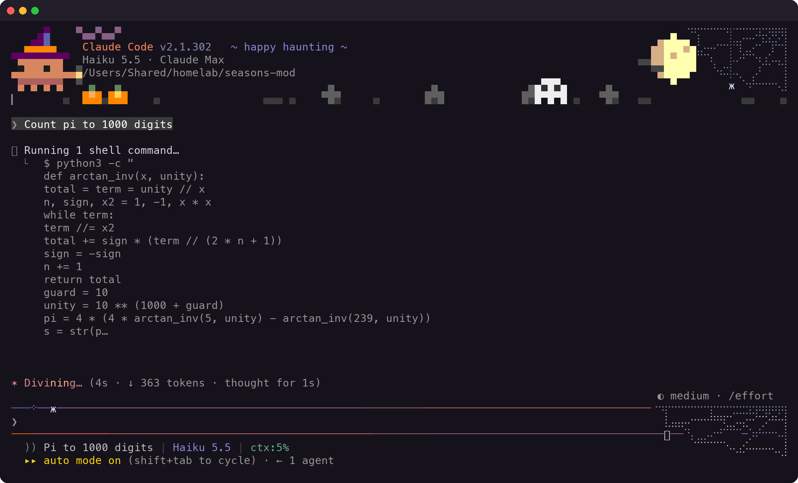

- **The logo block** is painted over: Clawd wears the month's hat (and holds something while
  Claude works), the title line takes the month's colors with a tagline that changes now and then,
  and the sky at the right holds a moon, a sun, a rainbow or a heart. Under the logo, one row of
  ground with a few props and someone wandering about.
- **The prompt box** gets the month's border colors and a decoration hanging from its top right
  corner, on the right where it stays clear of your draft and the newest text (it steps off the
  draft's row when a long line reaches it). A critter lives on the top border: it runs to your
  caret while you type, patrols while Claude works, leaves a little something at every tool call,
  and tidies up once the turn is done. Something drifts along the bottom border while a turn runs.
- **Every tool call** sends something out of Clawd's hat across the top row (bats, birds, geese,
  paper airplanes, fireworks, shooting stars). Clawd hops when a turn ends.
- **Before your first prompt** something comes down into the empty screen to say hello and goes
  home when you send something.
- **The spinner and the closing line** speak the month ("Raising the dead…", "Brewed for 12s").
  Every word is listed in [docs/SAYINGS.md](docs/SAYINGS.md).

Nothing flashes: every light change is a slow fade. Bash mode keeps the engine's own border color.
Terminal only.

## The months

| | | |
|---|---|---|
| 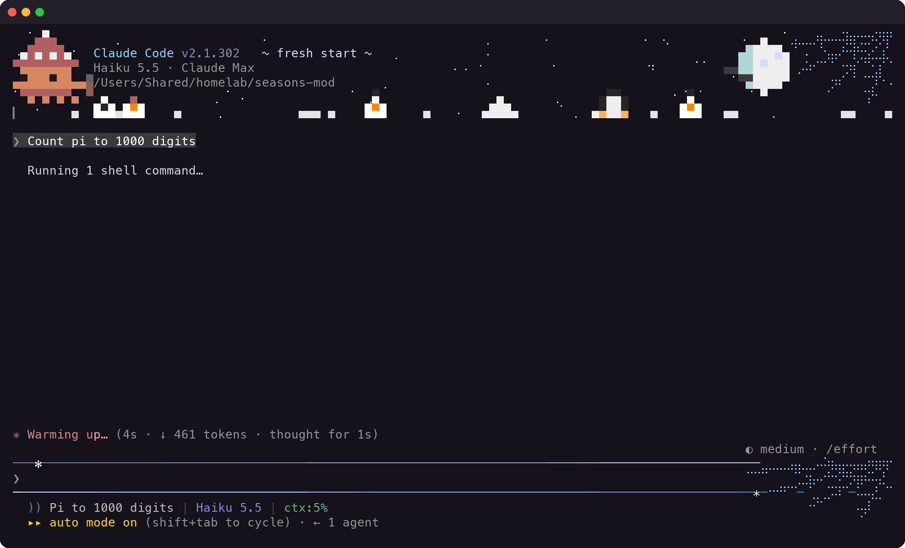 | 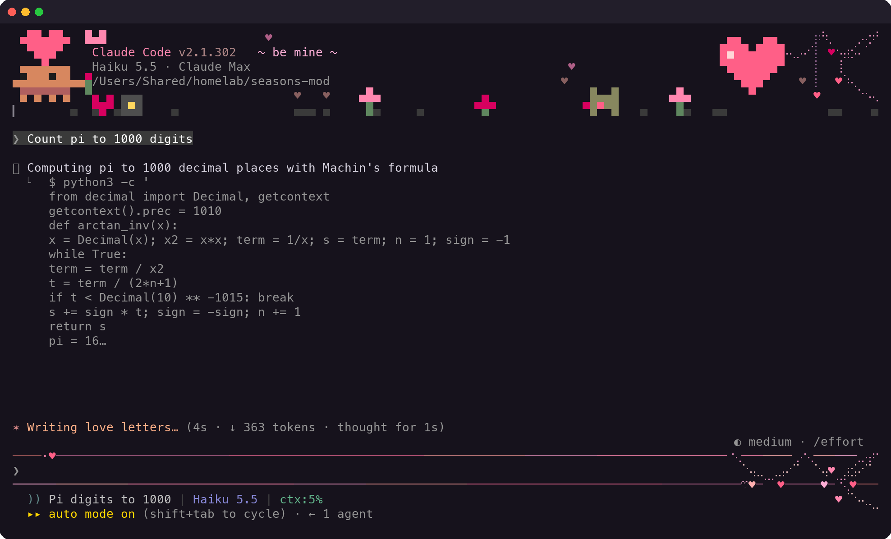 | 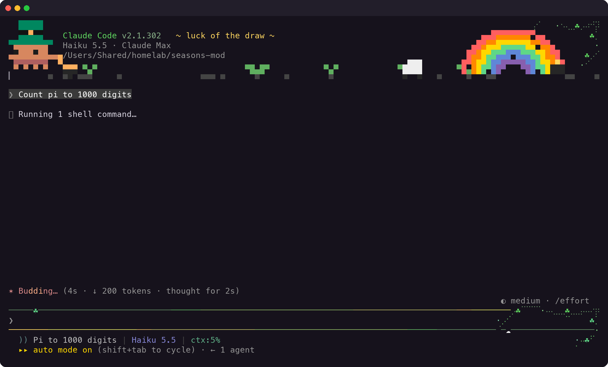 |
| 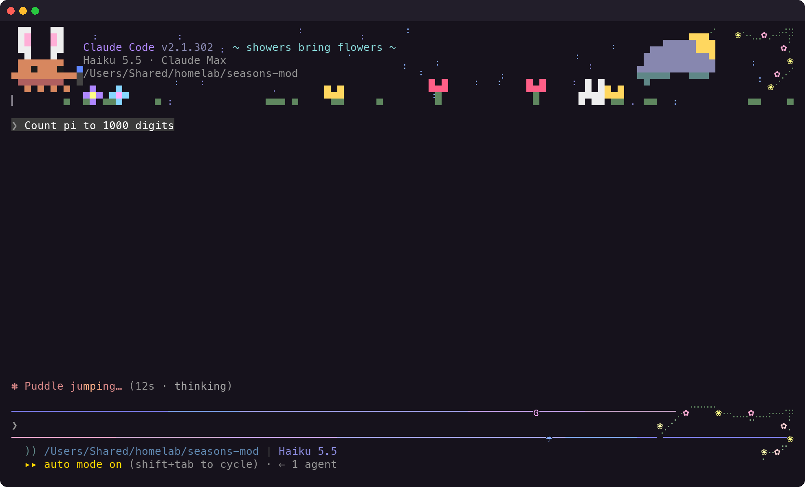 | 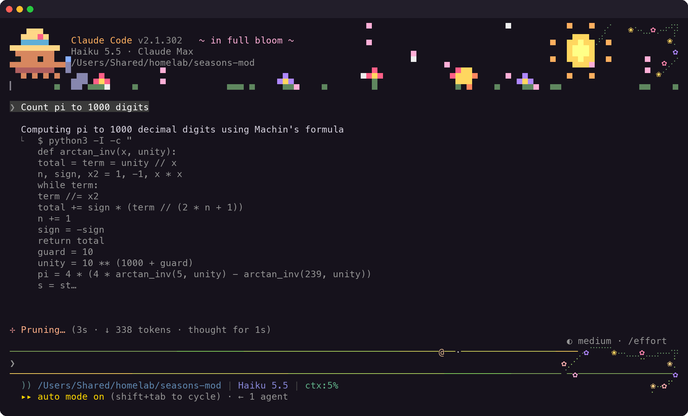 | 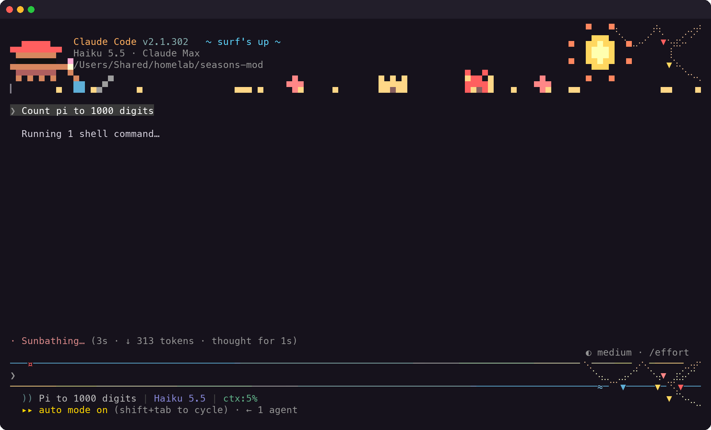 |
| 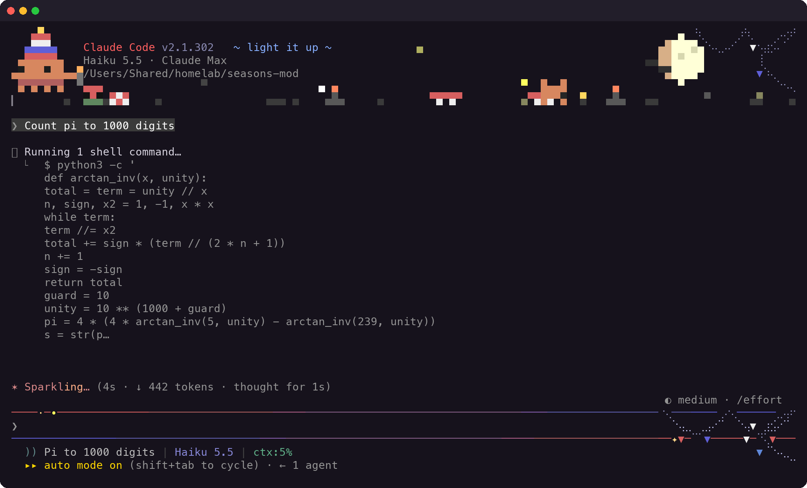 | 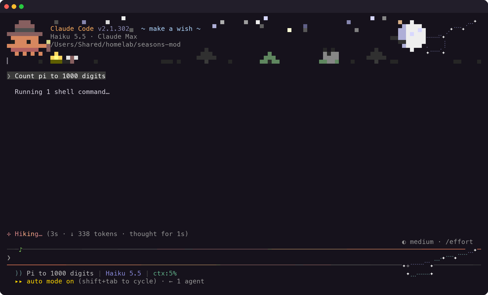 | 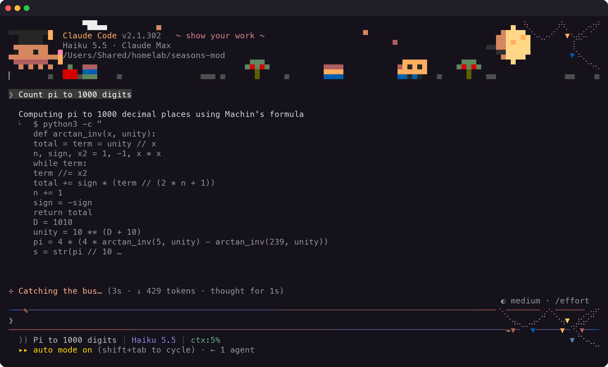 |
|  | 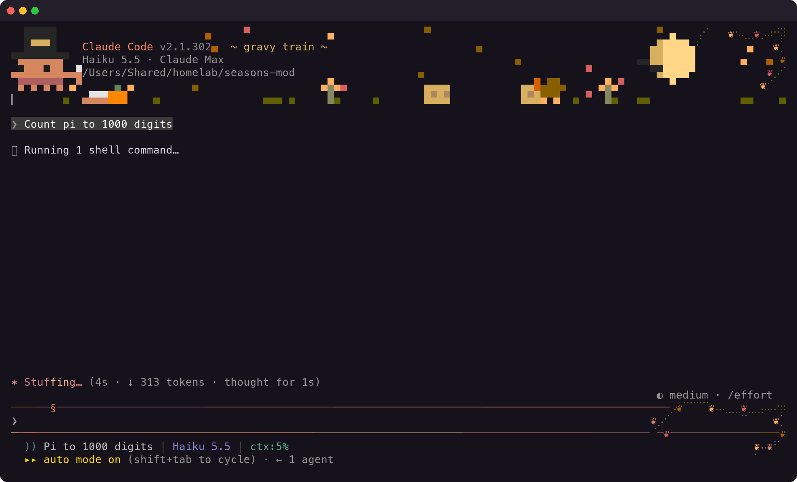 | 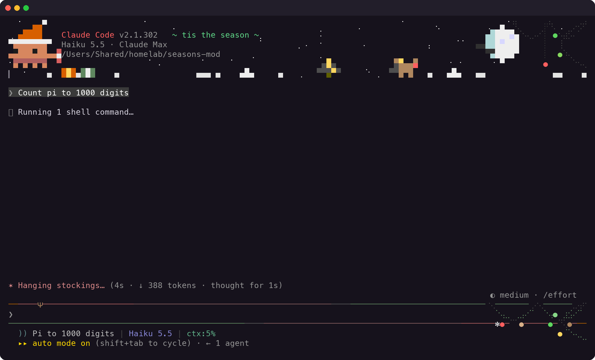 |

Each was taken mid-turn on "Count pi to 1000 digits", with `scripts/shoot.sh`.

## Commands

- `/seasons` turns the decorations off or on (remembered across sessions); `/seasons off`,
  `/seasons on` say which.
- `/seasons mar` (or `march`, or `3`) shows another month for this session; `/seasons auto` goes
  back to the calendar.
- `SEASONS_MONTH=3 claude` starts a session on that month.

## Install

At the prompt of a terminal session:

```
/plugin install seasons --marketplace snedea/seasons-mod
```

Answer `y` to add the marketplace, then pick a scope.

From a shell:

```
claude plugin install seasons --marketplace snedea/seasons-mod
```

In the desktop app: click + next to the prompt box, then Plugins, Add marketplace with
`snedea/seasons-mod`, then Add plugin.

### Turn on the logo decorations

Claude Code has no render site for the logo block itself, but the notice line under it is one.
The mod draws from the `tmux session: seasons` notice (up over the logo, with absolutely placed
cells), which the engine shows whenever `CLAUDE_CODE_TMUX_SESSION` is set. Add it to
`~/.claude/settings.json`:

```json
{ "env": { "CLAUDE_CODE_TMUX_SESSION": "seasons" } }
```

A real `claude --tmux` session sets its own name there, and the mod leaves that notice alone.
If the engine has more notices than it shows ("1 more notice hidden", as under `--debug`), the
logo decorations wait for a start without them; the prompt box is decorated regardless.

The prompt decorations assume the fullscreen layout (`"tui": "fullscreen"`) and a status line of
at most one row.

## Making a month

Each month is one file in `hooks/months/`: what Clawd wears and holds, the sky, the flyers, the
ground row, the corner decoration, the critter, and colors. Its words are in `hooks/words.ts`.
`hooks/scene.ts` moves and places everything. After changing words, run `node scripts/sayings.ts`;
after changing looks, `scripts/shoot.sh <month number>` retakes that screenshot.

## Credits

Scene style follows the pixel-art header engine in [floweyes](https://github.com/floweyes/floweyes).
